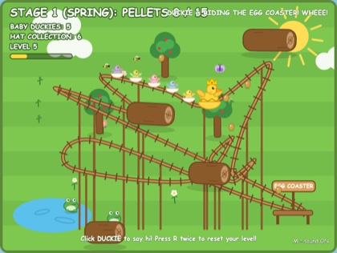
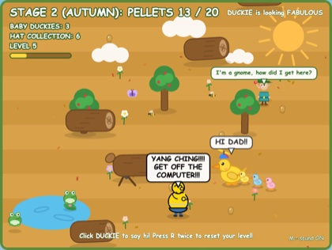
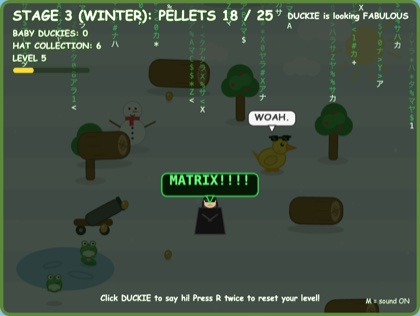
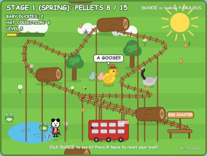
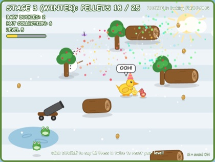
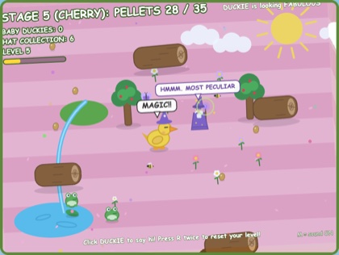

# DUCK GAME

You can play it at [catchouli.github.io/yang-ching-super-coder-duck-game](https://catchouli.github.io/yang-ching-super-coder-duck-game/).

A fun, cute little idle game about a duck called Duckie, made by YANG CHING, 11-year-old
SUPER CODER.

(Yang Ching isn't real, it's a joke! This is a humorous parody game, written as if it was
made by an over-excited kid who just learned to code and kept adding everything they could
think of.)

It runs in your browser, so there's nothing to install. You don't really have to do anything
either: Duckie wanders around by themself eating food, laying eggs and generally having a nice
time. But almost everything in the game does something if you click on it, and a lot of it is
pretty silly.

## What's in it

**Duckie** waddles around eating pellets, napping, having a drink at the pond and chasing the
butterfly. Every couple of pellets they lay an egg, which hatches into a baby duckie that
follows them around in a little line until it grows up and leaves home. You can pick Duckie up
and carry them around, or pick a flower and give it to them, and they'll love you a bit more.

**Stages** go through spring, autumn, winter, night and cherry blossom, and each one has a
different ride for Duckie to go on: the egg coaster, a catapult, a cannon, a trampoline and a
slide. Duckie also levels up as they go, which gets saved between visits, and higher levels
unlock fancier eggs.

**Visitors** turn up every now and then. There's a mean goose, a wizard, a lost gnome, Maisy in a
big red bus, a man in a red car with important things to say, and Yang Ching's dad, who would like
them to get off the computer. Hats appear sometimes too, and one of them is very special.

**Clicking on things** is half the fun, so I won't spoil all of it, but try the sun, the pond,
the trees, the clouds and the snowman. Please don't chop down the trees.

Press M to mute the sound, R twice to reset Duckie's level, and space to skip the stage clear
screen.

## Running it locally

You'll need Node. Run `npm install` and then `npm run dev`, and it'll give you a localhost link
to open. `npm run build` puts a normal static site in `dist`.

Pushing to `main` builds it and deploys it to GitHub Pages with GitHub Actions (you'll need to
set Settings → Pages → Source to "GitHub Actions" the first time).

The code is all plain JavaScript in `src`, split up by what it's for: `duck` has Duckie and the
babies, `critters` and `characters` have everything that visits, `world` has the scenery and
`effects` has the fireworks and particles. Everything shares one `game` object from `state.js`,
and `update.js` and `render.js` tick and draw it all each frame.
